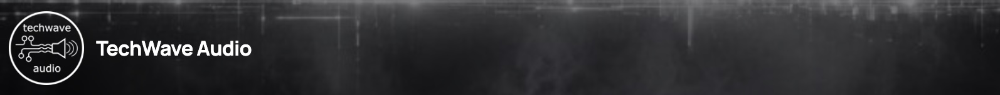
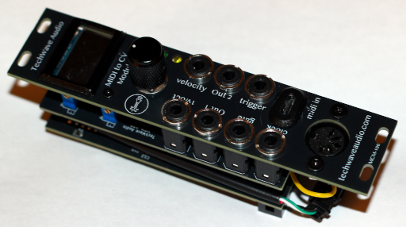

## TechWave Audio

TechWave Audio is a proudly Canadian small business dedicated to producing open source software (OSS) and open source hardware (OSHW) devices for audio production.

It started with a love of music, electronics, and software design and the intersection of these three things was a natural extension from there.

## Current Projects

### [MCM-100 Midi to CV Module](https://github.com/TechWave-Audio/TechWaveAudio-MidiControllerModule)

